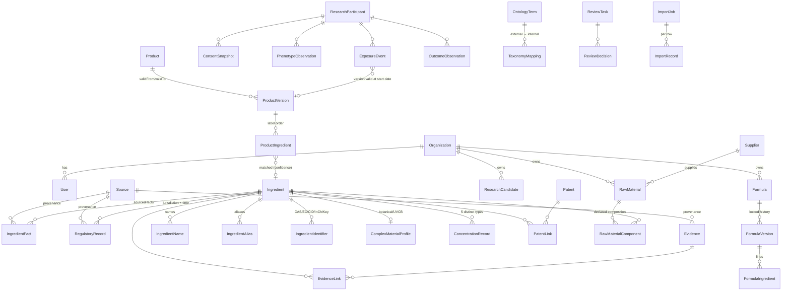

# Architecture — Supernatural Ingredient Intelligence (Phase 1)

## 1. Assessment of the existing system

The existing Supernatural app (`claude/supernatural-journey-app-wxdict` branch) is a consumer-facing journey and Hair Passport experience. Hair Passport currently keeps product use **in each customer's browser**: there is no server-side store of product logs, observations or outcomes to integrate with.

Ingredient Intelligence is therefore built as a separate application in `/intelligence`, with its own database, login and permissions. It does not modify or rebuild Hair Passport. The two systems meet only at the versioned contract described in `hair-passport-integration-contract.md`.

## 2. System architecture

```mermaid
flowchart LR
  subgraph Clients
    UI[Research web app<br/>Next.js server components]
    API[Partner / system clients<br/>Bearer API keys]
    HP[Hair Passport<br/>future, via contract]
  end
  subgraph App[Next.js application]
    RSC[Pages + server actions]
    V1["/api/v1 route handlers<br/>route(): auth · scope · rate limit · CSRF · errors"]
    SVC[Domain services<br/>ingredients · facts · identity · products · formulas · review · graph · search · imports · integration]
    LIB[Pure libraries<br/>units · INCI parser · formula math · claims guard · completeness · rubric]
  end
  DB[(PostgreSQL<br/>pg_trgm · unaccent<br/>append-only audit trigger · CHECK constraints)]
  FS[(Object storage<br/>local adapter → S3/Supabase)]
  AV[ClamAV optional]
  UI --> RSC --> SVC
  API --> V1 --> SVC
  HP -. hp-ii/0.1.0-draft .-> V1
  SVC --> LIB
  SVC --> DB
  SVC --> FS
  SVC --> AV
```

- **Single deployable.** Pages call services directly; external clients use `/api/v1`. Both share the same services, so permission and provenance rules are enforced in one place.
- **Services own the invariants.** For example, facts are never overwritten, product lists are versioned, formula versions lock, and reviews cannot be self-approved. UI and API layers only validate input shape.
- **Pure libraries are unit-tested without a database.** These cover unit conversion, INCI parsing, formula arithmetic (integer math at 1e-5 % precision), the claims guard, completeness and the review state machine.
- **Background work.** Imports run in-process with a resumable cursor (25-row chunks). This is adequate for Phase 1 volumes. A queue worker is planned for Phase 2.

## 3. Data model (core ERD)

68 Prisma models. This diagram shows the spine; the full schema is in `prisma/schema.prisma`.



Design rules encoded in the schema:

- **Provenance on every fact.** Each fact records `sourceId`, `sourceLocation`, `entryMode` (IMPORTED / AI_EXTRACTED / MANUAL), `confidence`, `reviewStatus` and `reviewedBy/At`. Measurements also keep the original value, unit and conditions alongside the normalized form.
- **Conflicts are preserved.** A new value never overwrites an old one. Supersession sets `supersededAt` and `supersededById`, and disagreeing current values are shown side by side.
- **Time.** Regulatory records carry `effectiveDate`, `lastCheckedAt` and `staleAfterDays`. Product lists carry `validFrom`/`validTo`; exposure resolves the version that applied on the exposure date.
- **Ownership.** Formulas, raw materials, documents and research candidates carry `ownerOrgId` and a `visibility` of SHARED, ORGANIZATION, RESTRICTED or CONFIDENTIAL_IP. There is no cross-organization bypass, not even for super admin.
- **Database guards.** The AuditLog has an append-only trigger. CHECK constraints cover evidence level 1–7, percentages 0–100, formula lines referencing a material, active % in (0, 100], concentration min ≤ max, edge confidence 0–1 and label position ≥ 1.

## 4. Knowledge graph

Edges live in `GraphEdge` (unique on from, to and type) with typed endpoints (`NodeType`) and 24 edge types, including CONTAINS, USED_IN, SUPPLIED_BY, HAS_FUNCTION, STUDIED_IN, ASSOCIATED_WITH, RESTRICTED_BY, PROHIBITED_BY, CLAIMED_IN_PATENT, SUPPORTS, CONTRADICTS and GENERATED_HYPOTHESIS. Each edge carries:

- source, confidence and evidence type
- status: PROPOSED, ACTIVE or DEPRECATED
- review status, and whether the edge is derived

Edges are created as side effects of domain operations (label parsing, formula creation, regulatory import, evidence linking). They start unreviewed and are drawn dashed in the explorer.

Access goes through a `GraphStore` interface. Phase 1 implements it in Postgres (`postgresGraphStore.neighborhood`, which applies the caller's visibility to endpoint records). The interface allows a dedicated graph database later without touching callers. With 1,421 edges, Postgres is appropriate; reconsider beyond about 10⁶ edges or for multi-hop path queries.

## 5. Identity resolution

- **Canonical record.** Each ingredient has a canonical record, plus names (INCI, common, chemical, trade) and aliases (synonym, misspelling, label display).
- **Identifiers are checksum-validated.** CAS and EC are verified by check digit. An identifier already attached to a different ingredient is stored as a CONFLICT and quarantined, never silently reassigned.
- **Complex materials** (botanicals, polymers, UVCB, ferments) are not forced into single-substance identifiers. A `ComplexMaterialProfile` holds the botanical source, plant part, extraction method and solvent, and completeness treats chemical identifiers as not applicable.
- **Matching never merges automatically.** Label matching (`services/matching.ts`) assigns a confidence by method:
  - exact: 1.0
  - synonym: 0.95
  - misspelling or parenthetical-stripped: 0.85
  - label display: 0.7

  Ambiguous or unmatched lines go to a quarantine queue. Near-duplicate canonical records become `IdentityResolutionCandidate`s.
- **Merges are reversible.** A merge snapshots the moved child rows so `unmerge` can restore them.

## 6. Search

Every searchable entity is written into `SearchEntry` (normalized term, kind, owner org and visibility), with GIN trigram indexes. A query is normalized (case, accents, whitespace, punctuation), then ranked in tiers:

1. exact canonical / INCI
2. identifier (CAS, EC, CID, InChIKey)
3. alias / synonym
4. prefix
5. trigram similarity
6. substring

Each hit returns a human-readable explanation (`why`), and results are filtered by permission and record visibility before ranking. `scripts/search-eval.ts` measures top-1 accuracy, recall@5 and MRR@5 on a labelled set; the current result is 45/45 top-1 at p95 10 ms. That set was written by the developer and is a regression baseline, not a real-user benchmark; it should be extended with logged queries (`SearchLog`).

## 7. AI architecture

AI was used offline to propose seed classifications. Those carry `entryMode = AI_EXTRACTED` and remain `SUBMITTED` until reviewed. At runtime there is one generative component, the **research assistant** (`src/lib/research/assistant.ts`):
- **Retrieval first.** The question is matched against ingredients, evidence, regulatory records and products the user may see. Each record becomes a numbered reference (R1…Rn).
- **Answers cite records.** The model returns structured output (JSON schema). Any point that cites no reference, or cites one that was not retrieved, is dropped, and the methodology says so.
- **Off without a key.** Without `ANTHROPIC_API_KEY`, the assistant returns the retrieved records only (`aiUsed: false`). Each AI call is metered against the plan.
- **Answers are labelled** as drafts for qualified review, and saved projects can be sent for review.
- **Technical values are never generated.** Ingredient dimensions (HLB, pH range, solubility, …) appear only with a source; otherwise they read *Missing*.

Still planned: embeddings (pgvector) gated by `allowModelTraining`/`fullTextStoragePermission`, AI-assisted extraction from supplier documents with human verification, and HairFM hypothesis intake as `AI_ESTIMATE` observations.

## 7a. Research workbench

All workflows (`src/lib/research/*`) return one `WorkflowResult`: summary, findings (each with a certainty level and citations), tables whose cells carry a data status, limitations, open questions and next steps. `ResearchProject` stores the objective, inputs, members, visibility and review status; each run is a `ResearchRun` and each report a frozen `ResearchReport` snapshot. Re-running an approved project sets it to `RE_REVIEW_REQUIRED`.

| Workflow | Engine | Notes |
|---|---|---|
| Substitutes | `substitutes.ts` | Ranks by overlap of official CosIng functions (IDF-weighted), adjusts for charge class, excludes avoided classes and EU-prohibited records. Never claims equivalence. |
| Formulation | `formulation.ts` | Parses pasted or uploaded formulas; checks totals, cationic–anionic pairing, preservation, pH-dependent preservatives, known incompatibilities, regulatory status per market, allergens and functional coverage. |
| Claim | `claim.ts` | Maps claim words to outcome terms; flags drug or proof wording; grades each element from reviewed human studies only. |
| Suppliers | `suppliers.ts` | Lists visible raw materials, documents and specifications; reports gaps. No invented suppliers or prices. |
| Comparison | `compare.ts` | 2–6 ingredients side by side; every cell labelled with its status. |
| Product brief | `brief.ts` | Founder wizard; building blocks per category, market guidance with official links, manufacturer checklist. No percentages or prices. |

**Data foundation.** `seed/cosing.ts` imports the EU CosIng inventory (OBF snapshot) idempotently, links existing curated records by exact INCI, and writes identifiers as `UNVERIFIED`. `src/lib/classify.ts` (`classify-rules/1.0.1`) derives screening classes from INCI naming and official functions; results are cached in `Ingredient.derivedClasses` with the rule version.

**Organizations and plans.** `src/lib/entitlements.ts` defines plans and monthly limits; usage is written to `UsageEvent`. No payment provider is integrated.

## 8. Page map

| Area | Pages |
|---|---|
| Research | Home `/` (research-first, by workspace mode), Workbench `/workbench` (projects, new research), Founder wizard `/founder`, Reports `/reports`, Product benchmark `/products/compare`, Ingredients (list with 13 filters, detail with 17 tabs, new), Search, Knowledge graph, Formulas (list, detail with versions/validation/compare/status, new), Products (list, detail with versions and line identity, new), Raw materials and Suppliers, Evidence (list, detail with rubric grading, new), Patents, Research candidates |
| Data | Data operations `/admin`, Hair Passport (mock) integration (batches, records, mappings), Imports (upload, jobs, ingestion queue, templates), Review queue (tasks, quarantine, identity, licensing, stale), Sources & rights, Phase 1 completion |
| Admin | Audit history, Organizations, Settings (account, MFA, users and roles, API keys, permission matrix, review requirements), API docs |

Every navigation entry leads to a working page; there are no placeholder pages.

## 9. Phases

| Phase | Scope | Status |
|---|---|---|
| 0 | Assessment, architecture, data-rights review, contract design | Done (this document; integration contract) |
| 1 | Canonical ingredient database, provenance, identity, search, products, formulas, evidence, patents, regulatory drafts, review workflows, imports, graph, API, Hair Passport mock contract | Built. Review-dependent targets are open; see `/completion`. |
| 2 | Connectors: CosIng (INCI/CAS/EC/functions), PubChem/CompTox live refresh, PubMed E-utilities, PatentsView/EPO OPS, Health Canada and UK lists; supplier-document OCR and extraction; queue worker; S3 storage; reviewer onboarding to work down the review backlog | Planned |
| 3 | Hair Passport live integration (after contract validation with that team), cohort builder, observational signal detection with pre-registered analysis plans and statistics governance | Planned |
| 4 | Retrieval-augmented assistant with citations (built; needs `ANTHROPIC_API_KEY`), embeddings (pgvector), HairFM hypothesis intake | Partly built |
| Expansion | CosIng inventory (~22k ingredients), rule-derived classes, status-labelled technical profiles, research workbench, founder wizard, reports, organization workspaces and plans, self-service signup | Built |

## 10. Cost (indicative monthly, small team)

| Item | Phase 1 | Notes |
|---|---|---|
| Managed Postgres (2 vCPU, 4–8 GB) | US$25–100 | e.g. Supabase Pro / Neon / RDS small |
| App hosting (Node server) | US$0–50 | Vercel Pro or a small container |
| Object storage + backups | under US$10 | Supplier documents are small |
| ClamAV | US$0–20 | Sidecar container |
| Data sources | US$0 | All Phase 1 sources are free; CAS Registry and commercial databases would be licence decisions |
| AI (Phase 4) | Usage-based | Not incurred in Phase 1 |

The main cost is **qualified reviewer time**: cosmetic chemist, regulatory, dermatology/trichology and patent professionals (see `governance.md`).

## 11. Performance

Measured locally with 289 ingredients and 2,354 search entries:
- search p95 is 10 ms
- the ingredient detail page with 17 tabs is server-rendered with one primary query
- imports process about 25 rows per transaction chunk

Indexes: trigram GIN on search, alias and name terms; foreign-key indexes; unique constraints for idempotency (ExternalRef, IntegrationRecord revision, GraphEdge triple). Expected Phase 2 volume (around 30k CosIng ingredients and 10⁵ facts) fits comfortably in a single Postgres instance. Revisit at 10⁷ facts or for heavy graph traversal.
